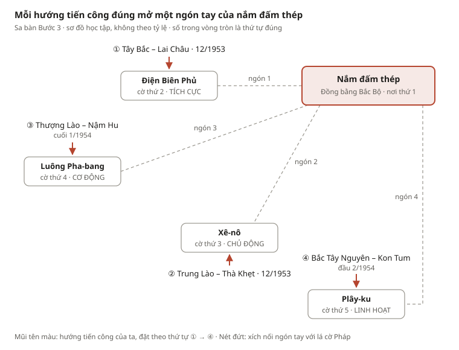

# Thiết kế GĐ2 – Phòng 2: Bàn cờ Đông Dương

Oct 30, 2026 · @BaoPham

## 1. Tóm tắt

Phòng 2 – "Bàn cờ Đông Dương" đưa Quang từ cái tên Henri Navarre (đáp án Phòng 1) đến quyết định mở Chiến dịch Điện Biên Phủ ngày 6/12/1953. Người chơi đọc trộm Kế hoạch Nava, bắt điện chủ trương Đông – Xuân, rồi tự tay bẻ mở "nắm đấm thép" của Nava trên sa bàn, kéo khối quân cơ động của Pháp tản ra 5 nơi. Mảnh ghép thứ hai nằm trong hòm sắt khóa bằng ngày 6/12.

Kế hoạch dựng màn chơi cho Thái: [Plan màn chơi (Thái)](gd2-room-2-level-plan.md)

| Mục | Nội dung |
| --- | --- |
| Giai đoạn | GĐ2: Kế hoạch Nava và cuộc tiến công chiến lược Đông – Xuân 1953–1954 (giữa 1953 – đầu 1954) |
| Phụ trách | Bảo, Thái |
| Quang mang vào phòng | Mảnh ghép 1 + tên Henri Navarre (từ Phòng 1 của Vy, Sơn) |
| Quang mang ra khỏi phòng | Mảnh ghép 2 + "Lệnh chuẩn bị chiến dịch" → Phòng 3 (Tiến, Hùng) bắt đầu từ 12/1953 |
| Chuỗi giải đố | 4 bước: cán cân 84 → hai giọng trên một sóng → nắm đấm thép → bản đồ gấp |
| Thời lượng chơi | 10–15 phút |
| Thông điệp | Sức mạnh nằm ở việc nắm tình hình, chủ động chọn hướng đánh và buộc địch phân tán lực lượng (đúng câu trong cốt truyện) |

## 2. Nội dung lịch sử GĐ2

Từ tháng 5/1953 đến tháng 2/1954, Pháp dồn sức theo Kế hoạch Nava, còn ta dùng cuộc tiến công Đông – Xuân kéo quân cơ động của Pháp tản ra 5 nơi. Ngày 6/12/1953, Bộ Chính trị chọn Điện Biên Phủ làm trận quyết chiến.

### 2.1. Kế hoạch Nava

- **Tháng 5/1953** (nhiều nguồn ghi 7/5/1953): Pháp cử tướng Henri Navarre làm Tổng chỉ huy quân viễn chinh Pháp ở Đông Dương, thay tướng Salan. Mỹ tăng viện trợ.
- **24/7/1953**: Hội đồng Quốc phòng Pháp thông qua kế hoạch. Mục tiêu: trong **18 tháng** giành thắng lợi quân sự quyết định, "kết thúc chiến tranh trong danh dự".
- **Bước 1** (thu – đông 1953 và xuân 1954): phòng ngự chiến lược ở miền Bắc; tiến công chiến lược để bình định miền Trung và miền Nam Đông Dương; xây dựng lực lượng cơ động mạnh.
- **Bước 2** (từ thu – đông 1954): chuyển lực lượng ra miền Bắc, tiến công chiến lược, giành thắng lợi quân sự quyết định.
- **Thực hiện**: tập trung **44 trong tổng số 84 tiểu đoàn cơ động** ở đồng bằng Bắc Bộ; đưa thêm 12 tiểu đoàn từ Pháp và Bắc Phi sang.

### 2.2. Chủ trương Đông – Xuân 1953–1954

- **Cuối tháng 9/1953**, Bộ Chính trị họp tại Tỉn Keo (Định Hóa, Thái Nguyên), do Chủ tịch Hồ Chí Minh chủ trì.
- **Phương hướng**: tập trung lực lượng tiến công vào những hướng quan trọng về chiến lược mà địch tương đối yếu, tiêu diệt một bộ phận sinh lực địch, giải phóng đất đai, buộc địch bị động **phân tán lực lượng**.
- **Phương châm**: "**tích cực, chủ động, cơ động, linh hoạt**" (một số tài liệu ghi thêm "đánh ăn chắc, đánh chắc thắng").

### 2.3. Bốn hướng tiến công và năm nơi tập trung quân

| Thứ tự | Thời gian | Hướng tiến công của ta | Pháp buộc tập trung quân ở |
| --- | --- | --- | --- |
| 1 | Trước Đông – Xuân | (Kế hoạch Nava) | Đồng bằng Bắc Bộ |
| 2 | 12/1953 (từ 10/12) | Tây Bắc: giải phóng Lai Châu (trừ Điện Biên) | Điện Biên Phủ |
| 3 | 12/1953 | Từ 21/12/1953: liên quân Việt – Lào tiến công Trung Lào, giải phóng Thà Khẹt | Xê-nô |
| 4 | Cuối 1/1954 | Liên quân Việt – Lào tiến công Thượng Lào, giải phóng lưu vực sông Nậm Hu, tỉnh Phông-xa-lì | Luông Pha-bang |
| 5 | Đầu 2/1954 | Tiến công Bắc Tây Nguyên, giải phóng Kon Tum, uy hiếp Plây-ku | Plây-ku |

Kết quả: khối cơ động của Nava bị xé lẻ, Kế hoạch Nava bước đầu bị phá sản. Lưu ý khi viết lời thoại: Pháp đã nhảy dù chiếm Điện Biên Phủ từ 20/11/1953; đòn vào Lai Châu buộc Nava đưa thêm 6 tiểu đoàn cơ động lên đó. Lai Châu (từ 10/12) đi trước Trung Lào (từ 21/12/1953), nên thứ tự theo ngày trùng thứ tự "nơi tập trung quân thứ mấy" của SGK.

### 2.4. Điện Biên Phủ và quyết định ngày 6/12/1953

- **20/11/1953**: Pháp nhảy dù chiếm Điện Biên Phủ (cuộc hành quân Castor – "Hải ly") để che chở Lai Châu và Thượng Lào. Điện Biên Phủ không nằm trong kế hoạch Nava ban đầu, dần mới thành trung tâm của kế hoạch.
- Pháp xây Điện Biên Phủ thành tập đoàn cứ điểm mạnh nhất Đông Dương: **49 cứ điểm, 3 phân khu** (Bắc: Độc Lập, Bản Kéo; Trung tâm: Mường Thanh; Nam: Hồng Cúm), **16.200 quân** khi trận đánh bắt đầu.
- **6/12/1953**: Bộ Chính trị, do Chủ tịch Hồ Chí Minh chủ trì, nghe Tổng Quân ủy báo cáo và **quyết định mở Chiến dịch Điện Biên Phủ**: tập trung đại bộ phận chủ lực tiêu diệt tập đoàn cứ điểm, giải phóng Tây Bắc.
- **Hạ tuần 12/1953**: thành lập Bộ Chỉ huy chiến dịch, Đại tướng Võ Nguyên Giáp làm Chỉ huy trưởng kiêm Bí thư Đảng ủy mặt trận. Đây là điểm bắt đầu của Phòng 3.

Ranh giới với Phòng 3: phương châm tác chiến "đánh nhanh, giải quyết nhanh" → "đánh chắc, tiến chắc" thuộc Phòng 3. Phòng 2 dừng ở quyết định 6/12/1953 và chỉ dùng phương châm **chiến lược** Đông – Xuân.

Môi trường làm việc của mình không mở được trang nguồn, nên các số liệu trên được đối chiếu giữa nhiều kết quả tìm kiếm và SGK Lịch sử 12 (mục 10). Nhóm nên đối chiếu lại SGK trước khi nộp.

## 3. Ý tưởng thiết kế

Ý tưởng cốt lõi: cơ chế chơi lặp lại chính bài học lịch sử. Nava muốn dồn quân cơ động thành một khối ở đồng bằng Bắc Bộ; người chơi thắng bằng cách đánh vào nơi địch yếu để khối đó tản ra. Mỗi nước đi đúng trên sa bàn làm quân cờ Pháp rời đồng bằng, nên người chơi thấy tận mắt "buộc địch phân tán" nghĩa là gì.

**Bố cục phòng: một căn phòng, hai bàn cờ.**

- **Bên trái – Bàn làm việc của Nava** (tông xám xanh, ánh đèn bàn): cán cân đồng, 84 quả cân, sổ kế hoạch 18 tháng.
- **Bên phải – Lán tham mưu Việt Bắc** (tông nâu đất, vách nứa): điện đài hai tai nghe, tờ lịch, nhật ký chiến sĩ, trang báo cũ.
- **Giữa phòng – Sa bàn Đông Dương**: trên đồng bằng Bắc Bộ đặt một bàn tay sắt nắm chặt; cửa ra và hòm sắt ở cuối phòng.

**Mục tiêu học tập – ra khỏi phòng, người chơi nói được:**

1. Mục tiêu và hai bước của Kế hoạch Nava (18 tháng, "kết thúc chiến tranh trong danh dự").
2. Pháp dồn 44/84 tiểu đoàn cơ động về đồng bằng Bắc Bộ.
3. Chủ trương Đông – Xuân của Bộ Chính trị (9/1953): đánh vào hướng quan trọng mà địch tương đối yếu, buộc địch phân tán; phương châm "tích cực, chủ động, cơ động, linh hoạt".
4. Bốn hướng tiến công và năm nơi tập trung quân của Pháp.
5. Ngày 6/12/1953, Bộ Chính trị quyết định mở Chiến dịch Điện Biên Phủ, nơi Pháp xây tập đoàn cứ điểm mạnh nhất Đông Dương.

**Khác biệt với các phòng khác – không lặp cơ chế:**

| Phòng | Cơ chế chính |
| --- | --- |
| Phòng 1 (Vy, Sơn) | Ghép thư xé, tọa độ bản đồ A-03, xếp 4 thẻ, bảng quy đổi ký tự → "Henri Navarre" |
| **Phòng 2 (Bảo, Thái)** | **Cán cân quả cân, tách hai bức điện đan xen, nắm đấm thép mở từng ngón, bản đồ gấp kiểu fold-in** |
| Phòng 4 (Trâm) | Ô chữ 7 câu, bảng chữ "tìm T và L" → "QUYẾT CHIẾN, QUYẾT THẮNG" |

Phòng 1 đã giải ra tên Henri Navarre, nên Phòng 2 không hỏi lại tên mà bắt đầu ngay từ nội dung kế hoạch của ông ta.

## 4. Chuỗi giải đố: "Nắm đấm của Nava"

Bốn câu đố, bốn cơ chế chưa có ở phòng nào, và mỗi cơ chế chính là một ý lịch sử. Cán cân cho thấy Nava dồn quân; hai giọng điện cho thấy hai chiến lược đối nghịch; nắm đấm xòe ra là sự phân tán; tấm bản đồ gấp là quyết định chọn Điện Biên Phủ.

| Bước | Câu đố | Cơ chế | Người chơi tự cảm được | Mở ra |
| --- | --- | --- | --- | --- |
| 1 | Cán cân 84 | Cân quả cân theo kế hoạch | Nava dồn hơn nửa quân cơ động (44/84) về Bắc Bộ | Cuộn băng điện báo |
| 2 | Hai giọng trên một sóng | Tách hai bức điện đan xen từng chữ | Nava TẬP TRUNG, ta buộc địch PHÂN TÁN | 4 thẻ mũi tên tiến công |
| 3 | Nắm đấm thép | Mở từng ngón tay sắt theo đúng trình tự | 4 hướng tiến công → 5 nơi tập trung quân; phương châm | Bản đồ gấp trong lòng bàn tay |
| 4 | Bản đồ gấp | Gấp giấy để lộ chữ ẩn (kiểu "fold-in") | Chọn Điện Biên Phủ, ngày 6/12/1953 | Mã 0612 → hòm sắt, mảnh ghép 2 |

### Bước 1 – Cán cân 84 (Kế hoạch Nava)

- **Vật phẩm**: trên bàn Nava có một cán cân đồng hai đĩa, "Đồng bằng Bắc Bộ" và "Các chiến trường khác"; cạnh đó là 84 quả cân nhỏ khắc chữ "tiểu đoàn cơ động". Có một sổ kế hoạch 18 trang, mỗi trang một tháng, và hai chiếc kẹp giấy "Bước 1", "Bước 2".
- **Cách chơi**:
  1. Kẹp "Bước 1" vào các trang thu – đông 1953 và xuân 1954, kẹp "Bước 2" vào các trang từ thu – đông 1954. Kẹp đúng thì hai dòng ghi chú ở lề trang nối liền: "84 tiểu đoàn cơ động toàn Đông Dương" và "40 tiểu đoàn cho mọi chiến trường còn lại".
  2. Tự tính 84 − 40 = 44, đặt 44 quả cân vào đĩa Bắc Bộ, 40 quả vào đĩa còn lại.
- **Kết quả**: cán cân nghiêng hẳn về Bắc Bộ và khóa chặt; ngăn bàn bật ra cuộn băng điện báo. Cán cân giữ nguyên thế nghiêng để Bước 3 "gọi lại".

### Bước 2 – Hai giọng trên một sóng

- **Vật phẩm**: băng điện báo chỉ có một dòng `T P A H P A T N R T U A N N G`. Điện đài có hai tai nghe, một ghi "Bộ chỉ huy Pháp", một ghi "Việt Bắc". Ghi chú dán trên máy: "Hai bức điện phát cùng lúc trên một sóng, chữ người này chen vào chữ người kia. Hãy nghe từng người một."
- **Cách chơi**: tách chữ ở vị trí lẻ và vị trí chẵn, rồi gán mỗi từ cho đúng bên.
- **Đáp án**: vị trí lẻ → **TẬP TRUNG** (Pháp); vị trí chẵn → **PHÂN TÁN** (ta). Gán ngược bên thì không mở, vì đây là chỗ kiểm tra hiểu bài.
- **Kết quả**: bức điện Việt Bắc hiện đủ (bản biên soạn): "Bộ Chính trị, cuối tháng 9/1953: tập trung lực lượng tiến công vào những hướng quan trọng mà địch tương đối yếu, buộc địch phải phân tán lực lượng. Phương châm: ▒ – ▒ – ▒ – ▒." Bốn chữ cuối bị nhòe. Khay điện đài nhả ra 4 thẻ mũi tên đỏ.

### Bước 3 – Nắm đấm thép (câu đố chính)

- **Vật phẩm**: giữa sa bàn Đông Dương (sơ đồ, không theo tỷ lệ) là một bàn tay sắt nắm chặt đặt trên đồng bằng Bắc Bộ. Ngón cái tì xuống đồng bằng; bốn ngón còn lại nối bằng xích tới bốn lỗ cắm cờ: Điện Biên Phủ, Xê-nô, Luông Pha-bang, Plây-ku. Năm ngón tay = năm nơi tập trung quân. Sa bàn có bốn ô đặt mũi tên: Tây Bắc – Lai Châu, Trung Lào – Thà Khẹt, Thượng Lào – sông Nậm Hu, Bắc Tây Nguyên – Kon Tum.
- **Manh mối rải quanh phòng** (mỗi mẩu nối một hướng đánh với phản ứng của địch):
  1. Nhật ký chiến sĩ: "Ta vào Lai Châu, máy bay địch đổ thêm quân xuống lòng chảo Điện Biên Phủ, nơi tập trung quân thứ hai."
  2. Tráng báo cũ: "Thà Khẹt giải phóng! Địch vội tăng quân giữ Xê-nô."
  3. Điện liên quân Việt – Lào: "Sông Nậm Hu sạch bóng giặc, địch co về giữ Luông Pha-bang."
  4. Tờ lịch tháng 2/1954: "Kon Tum giải phóng, địch dồn quân giữ Plây-ku, nơi tập trung quân thứ năm."
- **Cách chơi**: đặt mũi tên vào vùng. Mỗi mũi tên đúng chỗ, đúng lượt sẽ bẩy một ngón tay mở ra; sợi xích kéo lá cờ Pháp dựng lên ở điểm mới, vài quân cờ trượt khỏi đồng bằng, và cán cân trên bàn Nava nhích dần về thế cân bằng. Sai thứ tự thì cả bàn tay nắm lại, các ngón đã mở khép vào ("Nava gom quân lại") và người chơi làm lại. Thứ tự đúng là nơi tập trung quân thứ 2 → 5.

| Lượt | Mũi tên đặt vào | Ngón tay mở, cờ dựng ở | Chữ sau lá cờ |
| --- | --- | --- | --- |
| 1 | Tây Bắc – Lai Châu (12/1953) | Điện Biên Phủ | TÍCH CỰC |
| 2 | Trung Lào – Thà Khẹt (12/1953) | Xê-nô | CHỦ ĐỘNG |
| 3 | Thượng Lào – Nậm Hu (cuối 1/1954) | Luông Pha-bang | CƠ ĐỘNG |
| 4 | Bắc Tây Nguyên – Kon Tum (đầu 2/1954) | Plây-ku | LINH HOẠT |

Bố trí gợi ý cho người vẽ sa bàn: vị trí chỉ theo hướng tương đối trên bản đồ Đông Dương, không theo tỷ lệ.

- **Kết quả**: bốn chữ trên cờ điền vào chỗ nhòe của bức điện: phương châm "tích cực, chủ động, cơ động, linh hoạt". Bàn tay xòe hẳn, trong lòng bàn tay là một tấm bản đồ gấp và Hồ sơ Điện Biên Phủ (49 cứ điểm, 3 phân khu, 16.200 quân, tiếp tế chủ yếu bằng đường hàng không).

### Bước 4 – Bản đồ gấp: nước cờ quyết định

- **Vật phẩm**: tấm bản đồ dài in 5 lá cờ, mép trái là hình nắm đấm (đồng bằng Bắc Bộ). Rải rác trên bản đồ là những nét chữ đứt đoạn, đọc không ra. Dòng chỉ dẫn: "Gấp bản đồ để nắm đấm của Nava chạm vào nơi trận quyết chiến sẽ diễn ra."
- **Cách chơi**: chọn một lá cờ rồi gấp mép nắm đấm tới đó, giống trò "fold-in" của tạp chí MAD: phần giữa bị giấu đi, hai phần còn lại ghép thành hình mới. Người chơi phải tự suy luận từ Hồ sơ Điện Biên Phủ: mạnh nhất, nhưng xa hậu phương và sống nhờ máy bay.
- **Đáp án**: gấp tới **Điện Biên Phủ** thì các nét ghép thành "QUYẾT CHIẾN – 6 · 12 · 1953". Gấp tới nơi khác thì chữ ghép ra vô nghĩa, kèm một câu nhắc. Khóa hòm sắt (ngày – tháng) = **0612**.
- **Phần thưởng**: **mảnh ghép thứ hai** + "Lệnh chuẩn bị chiến dịch" (biên soạn). Cửa sang Phòng 3 mở.

Bản in (Canva) làm được cả bốn câu đố: bảng cân có thể thay bằng phiếu "chia 84 quân cờ", băng điện in một dòng chữ, bàn tay in 5 ngón gập được, bản đồ gấp in trên khổ ngang có vạch gấp.

## 5. Lời dẫn và lời thoại

Giọng hệ thống chỉ nói 3 lần (vào phòng, trước nước quyết định, khi mở hòm); phần còn lại là Quang tự nói, để người chơi nghe suy luận của nhân vật. Các bức điện, nhật ký, tráng báo trong phòng là văn bản biên soạn cho trò chơi, không phải nguyên văn tư liệu; game cần ghi rõ điều này.

| Thời điểm | Ai nói | Lời thoại |
| --- | --- | --- |
| Vào phòng | Hệ thống | "Ngươi đã biết tên người cầm quân Pháp. Giờ hãy đọc kế hoạch của hắn. Một bên muốn nắm chặt nắm đấm, một bên muốn buộc nắm đấm ấy xòe ra. Nước cờ đúng sẽ mở cánh cửa." |
| Nhìn quanh | Quang | "Bên trái là bàn của Nava, bên phải là một lán tham mưu. Ở giữa là cả Đông Dương thu nhỏ. Muốn biết ta đánh thế nào, trước hết phải biết địch định làm gì." |
| Giải xong Bước 1 | Quang | "Mười tám tháng, hai bước: giữ miền Bắc trước, dồn sức đánh lớn sau. Và 44 trong 84 tiểu đoàn cơ động đều nằm ở đồng bằng Bắc Bộ – hơn một nửa." |
| Giải xong Bước 2 | Quang | "Nava nói "tập trung", ta nói "phân tán". Ta cũng tập trung, nhưng tập trung đánh vào chỗ địch yếu để địch phải tự chia quân ra." |
| Mỗi ngón tay mở | Quang | "Địch lại phải rút quân khỏi đồng bằng…" (câu ngắn, đổi nhẹ theo từng nơi) |
| Giải xong Bước 3 | Quang | "Năm nơi tập trung quân. Nắm đấm của Nava đã thành năm ngón tay rời rạc. Tích cực, chủ động, cơ động, linh hoạt – mình vừa tự tay đi đúng bốn chữ ấy." |
| Trước Bước 4 | Hệ thống | "Năm ngọn cờ đã dựng. Muốn kết thúc kế hoạch của Nava, phải chọn đúng một nơi để đánh trận quyết chiến." |
| Chọn đúng | Quang | "Điện Biên Phủ mạnh nhất, nhưng nằm giữa núi rừng, xa hậu phương, sống nhờ máy bay. Đánh tan nơi này là đánh vào trái tim kế hoạch." |
| Mở hòm | Hệ thống | "Ngày 6/12/1953, quyết định đã được đưa ra. Mảnh ghép thứ hai thuộc về ngươi. Phía sau cánh cửa, cả một dân tộc đang chuẩn bị." |
| Rời phòng | Quang | "Sức mạnh không chỉ nằm ở đối đầu trực diện, mà còn ở việc nắm tình hình, chủ động chọn hướng đánh và buộc đối phương phải phân tán." |

## 6. Gợi ý, phản hồi khi sai và trợ năng

Mỗi bước có 2 mức gợi ý, giống game hiện tại: mức 1 chỉ chỗ cần nhìn, mức 2 gần như nói đáp án. Sai không bị phạt điểm; phản hồi luôn dạy thêm một ý lịch sử thay vì chỉ báo "sai".

| Bước | Gợi ý 1 | Gợi ý 2 | Khi làm sai |
| --- | --- | --- | --- |
| 1. Cán cân 84 | "Bước 1 bắt đầu từ thu – đông 1953; ghi chú ở lề trang mới nói số quân." | "84 − 40 = 44 tiểu đoàn cho đồng bằng Bắc Bộ." | Cân không khóa. Quang: "Nava muốn đĩa Bắc Bộ nặng hơn tất cả phần còn lại cộng lại." |
| 2. Hai giọng | "Thử đọc cách một chữ." | "Chữ lẻ: T-A-P-T-R-U-N-G. Ai muốn dồn quân?" | Gán ngược bên: "Người muốn dồn quân thành nắm đấm là Nava, không phải ta." |
| 3. Nắm đấm thép | "Manh mối nào nói "nơi tập trung quân thứ hai"?" | Bảng thứ tự: Lai Châu → Trung Lào → Thượng Lào → Bắc Tây Nguyên. | Sai vùng: mũi tên bật ra. Sai lượt: bàn tay nắm lại, Quang: "Nava kịp gom quân. Phải đánh đúng lúc." |
| 4. Bản đồ gấp | "Đọc lại Hồ sơ Điện Biên Phủ: nơi nào mạnh nhất nhưng sống nhờ máy bay?" | "Gấp tới Điện Biên Phủ." | Chữ vô nghĩa + câu nhắc theo nơi chọn, ví dụ đồng bằng Bắc Bộ: "Đây là nơi địch mạnh và gần hậu phương nhất." |

**Độ khó và thời lượng:** Bước 1 và 2 dễ (2–3 phút mỗi bước), Bước 3 khó nhất (4–5 phút), Bước 4 vừa (2–3 phút). Tổng 10–15 phút.

**Trợ năng (giữ đúng chuẩn game hiện tại):**

- Mọi thao tác kéo – thả đều có cách thay bằng bàn phím: ô chọn, nút ↑/↓, số đếm +/− cho quả cân.
- Không có bước nào chỉ dựa vào âm thanh hay màu sắc; mỗi ngón tay, lá cờ có nhãn chữ.
- Hiệu ứng gấp giấy và ngón tay mở có bản không chuyển động khi trình duyệt bật "giảm chuyển động".
- Biểu đồ, sa bàn, bản đồ đều ghi "sơ đồ học tập, không theo tỷ lệ".

## 7. Bộ câu hỏi ôn tập GĐ2

Bảy câu theo đúng mẫu GĐ4 của Trâm: đáp án ngắn, dùng được cho tài liệu nhóm hoặc làm ô chữ (viết hoa, không dấu). Mỗi câu ứng với một thứ người chơi đã chạm tay trong phòng.

| # | Câu hỏi | Đáp án | Ô chữ | Gắn với |
| --- | --- | --- | --- | --- |
| 1 | Kế hoạch Nava dự kiến giành thắng lợi quân sự quyết định trong bao nhiêu tháng? | Mười tám tháng | MUOITAM | Bước 1 |
| 2 | Nava tập trung bao nhiêu tiểu đoàn cơ động ở đồng bằng Bắc Bộ? | Bốn mươi bốn | BONMUOIBON | Bước 1 |
| 3 | Nước nào tăng viện trợ để Pháp thực hiện Kế hoạch Nava? | Mỹ | MY | Bước 1 |
| 4 | Cuộc tiến công Đông – Xuân buộc địch phải làm gì với lực lượng của chúng? | Phân tán | PHANTAN | Bước 2 |
| 5 | Phương châm "tích cực, chủ động, cơ động, …" còn thiếu từ nào? | Linh hoạt | LINHHOAT | Bước 3 |
| 6 | Sau khi ta giải phóng Lai Châu, Pháp phải tăng quân cho nơi nào, biến nơi đó thành nơi tập trung quân thứ hai? | Điện Biên Phủ | DIENBIENPHU | Bước 3 |
| 7 | Tập đoàn cứ điểm Điện Biên Phủ được chia thành mấy phân khu? | Ba | BA | Bước 4 |

Câu dự phòng: "Ngày nào Bộ Chính trị quyết định mở Chiến dịch Điện Biên Phủ?" → 6/12/1953 (không hợp ô chữ vì là số, hợp trắc nghiệm).

## 8. Triển khai trong game

Game trong repo `mat-ma-dien-bien-phu` hiện vẫn theo cốt truyện cũ (Minh, 4 phòng; phòng 2 là `campaign-map` về các đợt tiến công 1954). Phòng 2 mới thay chỗ `campaign-map` bằng một chương mới, ví dụ `navarre-plan`. Khó nhất là game hiện chỉ cho mỗi phòng **một** câu đố, còn Phòng 2 cần 4 câu nối tiếp.

| Việc | File trong repo | Thay đổi |
| --- | --- | --- |
| Nội dung | `src/content/story-data.js` | Chương mới thay `campaign-map`; lời dẫn; manh mối (sổ kế hoạch, băng điện, 4 mẩu tin, Hồ sơ ĐBP); 4 câu đố với `answerSpec` |
| Nhiều câu đố mỗi phòng | `src/core/game-rules.js`, `src/core/save-validation.js` | Chương có `puzzleIds` theo thứ tự; lưu `completedPuzzleIds`; phòng chỉ xong khi câu cuối xong |
| Chấm đáp án | `src/core/game-rules.js` (`evaluatePuzzle`) | 4 kiểu mới: `balance`, `interleave`, `fist`, `fold` |
| Giao diện câu đố | `src/ui/puzzle-view.js`, `src/ui/puzzle-styles.css` | 4 màn hình mới, đều chơi được bằng bàn phím |
| Phòng và đồ vật | `src/content/world-data.js`, `src/game/room-art.js` | Vị trí bàn Nava, lán tham mưu, sa bàn có bàn tay sắt, hòm sắt |
| Âm thanh | `src/audio/synth-voices.js` | Tiếng quả cân, nhiễu sóng, xích kéo, giấy gấp |
| Kiểm thử | `tests/game-rules.test.js` | Mỗi kiểu câu đố: đúng, sai, thiếu manh mối; thứ tự ngón tay; không nhảy cóc câu đố |

**Thứ tự làm:**

- [ ] Chốt nội dung và đáp án với nhóm (tài liệu này).
- [ ] Thêm hỗ trợ nhiều câu đố trong một phòng + kiểm thử (nền tảng cho cả Phòng 1, 3, 4).
- [ ] Dữ liệu Phòng 2 + 4 hàm chấm + kiểm thử.
- [ ] Giao diện 4 câu đố, làm Bước 3 (nắm đấm) trước vì khó nhất.
- [ ] Đồ họa phòng, hiệu ứng ngón tay mở, gấp giấy.
- [ ] Chơi thử trọn phòng trên máy tính, điện thoại, zoom 200%.

**Bản in Canva** (nếu nhóm trình bày bằng phiếu như Phòng 4): 4 phiếu – sổ 18 tháng kèm bảng chia 84 quân cờ, băng điện một dòng chữ, sa bàn với bàn tay 5 ngón gập được, bản đồ khổ ngang có vạch gấp.

## 9. Việc cần chốt với nhóm

Hạn nộp phần GĐ2 là 23h59 Oct 30, 2026. Năm việc dưới đây cần thống nhất trước khi làm phiếu Canva hoặc code.

- [ ] **Ranh giới Phòng 1 – Phòng 2 (Vy, Sơn):** Phòng 1 kết thúc ở tên Henri Navarre; Phòng 2 bắt đầu từ nội dung kế hoạch và không hỏi lại tên.
- [ ] **Ranh giới Phòng 2 – Phòng 3 (Tiến, Hùng):** Phòng 2 dừng ở quyết định 6/12/1953 và phương châm chiến lược Đông – Xuân; Phòng 3 nói phương châm tác chiến (đánh nhanh, giải quyết nhanh → đánh chắc, tiến chắc). Cần ghi rõ hai chữ "chiến lược" và "tác chiến" để người chơi không nhầm.
- [ ] **Hình trên mảnh ghép 2:** bức tranh trên cửa cuối chia 4 mảnh thế nào? Đề xuất: mảnh 2 là hình bàn tay xòe ra trên bản đồ Đông Dương.
- [ ] **Nhân vật trong game:** cốt truyện mới dùng Quang, game hiện dùng Minh và 4 phòng; cần người phụ trách chuyển game sang 5 phòng.
- [ ] **Hạn của Quang và Thiện:** tài liệu ghi "thứ 7 (1/11)", nhưng 1/11/2026 là Chủ nhật; thứ Bảy là 31/10.

Chia việc đề xuất trong cặp Bảo – Thái: một người lo nội dung lịch sử, câu hỏi và phiếu Canva; người còn lại lo thiết kế câu đố và phần game.

## 10. Nguồn tham khảo

Các trang dưới đây hiện ra trong kết quả tìm kiếm và khớp nhau về số liệu. Mình chưa mở trực tiếp được trang nào vì mạng của môi trường làm việc bị chặn, nên cần một người trong nhóm mở kiểm tra trước khi đưa vào bản nộp.

1. SGK Lịch sử 12 (chương trình cũ), Bài 20 – Cuộc kháng chiến toàn quốc chống thực dân Pháp kết thúc (1953–1954): Kế hoạch Nava, Đông – Xuân, 5 nơi tập trung quân, tập đoàn cứ điểm.
2. [Báo Nhân Dân – Lừy lẫy Điện Biên, chấn động địa cầu](https://nhandan.vn/post-803638.html): Navarre thay Salan; họp Bộ Chính trị cuối 9/1953.
3. [Đại biểu Nhân dân – Chọn Điện Biên Phủ, quyết định lịch sử](https://daibieunhandan.vn/chon-dien-bien-phu-quyet-dinh-lich-su-10335081.html): quyết định 6/12/1953.
4. [Đề cương tuyên truyền kỷ niệm 70 năm Chiến thắng Điện Biên Phủ (bản đăng trên cổng Cần Thơ)](https://pbgdpl.cantho.gov.vn/de-cuong-tuyen-truyen-ky-niem-70-nam-chien-thang-dien-bien-phu-0751954-0752024): bối cảnh và diễn biến chung.
5. [VnExpress – Chiến địa Điện Biên Phủ sau 70 năm](https://vnexpress.net/chien-dia-dien-bien-phu-sau-70-nam-4736615.html): nhảy dù 20/11/1953; 49 cứ điểm, 3 phân khu.
6. [Lời giải hay – Kế hoạch Nava (Lịch sử 12)](https://loigiaihay.com/am-muu-moi-cua-phap-mi-o-dong-duong-ke-hoach-nava-a7945.html) và [Đông – Xuân 1953–1954 và Chiến dịch Điện Biên Phủ](https://loigiaihay.com/cuoc-tien-cong-chien-luoc-dong-xuan-1953-1954-va-chien-dich-dien-bien-phu-nam-1954-a7946.html): 18 tháng, hai bước, 44/84 tiểu đoàn, 5 nơi tập trung quân.
7. [Báo Lào Cai – Những quyết định cân não làm nên chiến thắng Điện Biên Phủ](https://baolaocai.vn/nhung-quyet-dinh-can-nao-lam-nen-chien-thang-dien-bien-phu-post382327.html): họp Bộ Chính trị 6/12/1953.

Với bản nộp chính thức, nên ưu tiên nguồn nhà nước giống phần GĐ4 (Bảo tàng Lịch sử Quốc gia, đề cương của Ban Tuyên giáo, Tư liệu Văn kiện Đảng) và bỏ đuôi `?utm_source=chatgpt.com` ở link.
