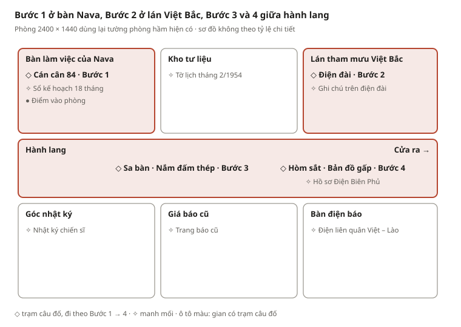
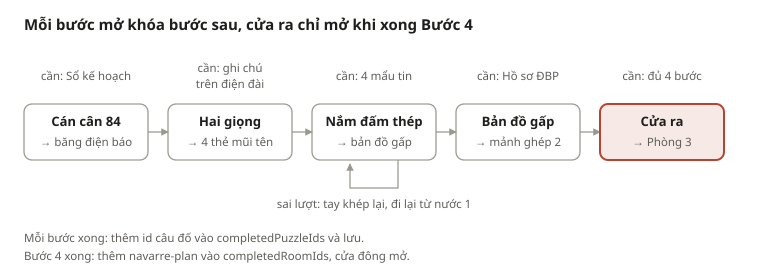

# Plan màn chơi GĐ2 – Phòng 2 (Thái làm)

Kế hoạch dựng màn 2 "Bàn cờ Đông Dương" trong game Phaser của repo `mat-ma-dien-bien-phu`, theo [thiết kế ở tab đầu](gd2-room-2-design.md).

## 1. Mục tiêu và phạm vi

Thái dựng trọn màn 2 trong game: một phòng khám phá, 4 câu đố nối tiếp, nhận mảnh ghép 2 khi xong, chơi được hoàn toàn bằng bàn phím và có lưu tiến độ.

**Trong phạm vi:**

- Phòng mới `navarre-plan` thay chỗ `campaign-map` trong chuỗi phòng.
- 4 câu đố: Cán cân 84, Hai giọng trên một sóng, Nắm đấm thép, Bản đồ gấp.
- Manh mối, lời dẫn, gợi ý 2 mức, phản hồi khi sai.
- Cơ chế nhiều câu đố trong một phòng (các phòng khác dùng lại được).
- Kiểm thử luật chơi cho 4 kiểu câu đố mới.

**Ngoài phạm vi** (việc chung của nhóm): đổi nhân vật Minh thành Quang, chuyển game sang 5 phòng, các phòng 1, 3, 4, 5 và cánh cửa ghép tranh cuối. Màn 2 chỉ cần ghi lại "đã nhận mảnh ghép 2" để phòng cuối đọc.

**Thế nào là xong:**

- [ ] Chơi trọn màn từ cửa vào tới cửa ra trong 10–15 phút, không kẹt.
- [ ] `npm test` và `npm run build` đạt.
- [ ] Mọi thao tác làm được bằng bàn phím; không bước nào chỉ dựa vào âm thanh hay màu.
- [ ] Tải lại trang giữ các câu đố đã giải.
- [ ] Mọi số liệu lịch sử trong game khớp mục 2 và có nguồn trong sổ tay.

## 2. Dữ kiện lịch sử dùng trong màn chơi

Mọi con số và ngày tháng trong màn 2 lấy từ bảng này, không tự thêm. Bảng đã đối chiếu lại qua nhiều lượt tìm kiếm; các trang nguồn hiện ra trong kết quả tìm kiếm nhưng mình không mở trực tiếp được (mạng của môi trường chặn), nên Thái cần bấm mở kiểm lại trước khi chép vào sổ tay trong game.

| # | Dữ kiện | Dùng ở | Nguồn |
| --- | --- | --- | --- |
| 1 | 7/5/1953: Pháp cử tướng Navarre làm Tổng chỉ huy quân viễn chinh ở Đông Dương, thay tướng Salan, được Mỹ đồng thuận | Lời dẫn vào phòng | [Wikipedia – Kế hoạch Navarre](https://vi.wikipedia.org/wiki/K%E1%BA%BF_ho%E1%BA%A1ch_Navarre), [Nhân Dân](https://nhandan.vn/post-803638.html) |
| 2 | Kế hoạch được Hội đồng Quốc phòng Pháp thông qua 24/7/1953; mục tiêu giành thắng lợi quyết định trong 18 tháng | Bước 1 | [Nhân Dân – Một ngoại lệ của lịch sử](https://special.nhandan.vn/mot_ngoaile_cua_lichsu/index.html) |
| 3 | Bước 1 (thu – đông 1953, xuân 1954): phòng ngự chiến lược ở miền Bắc; tiến công chiến lược ở miền Nam; xây dựng quân cơ động mạnh. Bước 2 (từ thu – đông 1954): chuyển lực lượng ra Bắc, tiến công, giành thắng lợi quân sự quyết định | Bước 1 | [Wikipedia – Kế hoạch Navarre](https://vi.wikipedia.org/wiki/K%E1%BA%BF_ho%E1%BA%A1ch_Navarre), [Lời giải hay – Kế hoạch Na-va](https://loigiaihay.com/ke-hoach-na-va-cua-phap-mi-c84a13684.html) |
| 4 | Tập trung 44 trong tổng số 84 tiểu đoàn cơ động ở đồng bằng Bắc Bộ; tăng thêm 12 tiểu đoàn từ Pháp và Bắc Phi | Bước 1 | [Lời giải hay – Kế hoạch Nava](https://loigiaihay.com/am-muu-moi-cua-phap-mi-o-dong-duong-ke-hoach-nava-a7945.html) |
| 5 | Cuối 9/1953, Bộ Chính trị họp ở Tỉn Keo (Định Hóa, Thái Nguyên): tiến công vào hướng quan trọng mà địch tương đối yếu, buộc địch phân tán; phương châm "tích cực, chủ động, cơ động, linh hoạt" | Bước 2, 3 | [Nhân Dân](https://nhandan.vn/post-803638.html), [Báo Lào Cai](https://baolaocai.vn/chien-thang-dien-bien-phu-bai-hoc-doi-voi-su-nghiep-xay-dung-nen-quoc-phong-toan-dan-vung-manh-post382636.html) |
| 6 | 20/11/1953: Pháp nhảy dù chiếm Điện Biên Phủ (hành quân Castor) để che chở Lai Châu và Thượng Lào. Điện Biên Phủ **không nằm trong kế hoạch ban đầu**, dần mới thành trung tâm của Kế hoạch Nava | Bước 3, 4 | [VnExpress](https://vnexpress.net/chien-dia-dien-bien-phu-sau-70-nam-4736615.html), [Wikipedia – Chiến cục Đông Xuân](https://vi.wikipedia.org/wiki/Chi%E1%BA%BFn_c%E1%BB%A5c_%C4%90%C3%B4ng_Xu%C3%A2n_1953%E2%80%931954) |
| 7 | 6/12/1953: Bộ Chính trị do Chủ tịch Hồ Chí Minh chủ trì quyết định mở Chiến dịch Điện Biên Phủ | Bước 4 | [Báo Lào Cai – Những quyết định cân não](https://baolaocai.vn/nhung-quyet-dinh-can-nao-lam-nen-chien-thang-dien-bien-phu-post382327.html), [Đại biểu Nhân dân](https://daibieunhandan.vn/chon-dien-bien-phu-quyet-dinh-lich-su-10335081.html) |
| 8 | Từ 10/12/1953 ta tiến công Lai Châu; Nava đưa 6 tiểu đoàn cơ động tăng cường Điện Biên Phủ → nơi tập trung quân thứ 2 | Bước 3 | [Lời giải hay – Đông Xuân và ĐBP](https://loigiaihay.com/cuoc-tien-cong-chien-luoc-dong-xuan-1953-1954-va-chien-dich-dien-bien-phu-nam-1954-a7946.html) |
| 9 | Từ 21/12/1953 chiến dịch Trung – Hạ Lào; giải phóng Thà Khẹt, uy hiếp Xê-nô → nơi tập trung quân thứ 3 | Bước 3 | [QĐND – Hậu cần mở đầu Đông Xuân](http://hc.qdnd.vn/lich-su-hau-can/bao-dam-hau-can-mo-dau-chien-cuoc-dong-xuan-1953-1954-482495) |
| 10 | Cuối 1/1954 tiến công Thượng Lào, giải phóng tỉnh Phông-xa-lì, lưu vực sông Nậm Hu → Luông Pha-bang là nơi thứ 4 | Bước 3 | [Luật Dương Gia – Đông Xuân 1953–1954](https://luatduonggia.vn/giao-duc/cuoc-tien-cong-chien-luoc-dong-xuan-nam-1953-1954/) |
| 11 | Đầu 2/1954 tiến công Bắc Tây Nguyên, giải phóng Kon Tum, uy hiếp Plây-ku → nơi thứ 5 | Bước 3 | [Lời giải hay – câu hỏi 5 nơi tập trung quân](https://loigiaihay.com/cau-hoi-110635.html) |
| 12 | Tập đoàn cứ điểm: 49 cứ điểm, 3 phân khu (Bắc, Trung tâm, Nam), 16.200 quân | Bước 4 | [VnExpress](https://vnexpress.net/chien-dia-dien-bien-phu-sau-70-nam-4736615.html) |
| 13 | Hai sân bay: Mường Thanh (chính), Hồng Cúm (dự bị); tiếp tế, tiếp viện đều dựa vào đường không | Bước 4 | [Sở VHTTDL Điện Biên – Phân khu Nam](https://svhttdl.dienbien.gov.vn/portal/pages/2020-6-22/Phan-khu-phia-Nam-cua-Tap-doan-cu-diem-Dien-Bien-Pq3vk99p081mt.aspx), [Tiền Phong – Hồng Cúm](https://tienphong.vn/70-nam-chien-thang-dien-bien-phu-bai-10-hong-cum-noi-tan-quan-co-thu-post1631479.tpo) |

**Điều chỉnh so với tab thiết kế:**

- Lời thoại không được nói Nava "đặt cược tất cả vào Điện Biên Phủ ngay từ đầu" (dữ kiện 6). Câu đúng: Điện Biên Phủ trở thành trung tâm của Kế hoạch Nava, nên tiêu diệt nó là phá kế hoạch.
- Trung Lào bắt đầu 21/12/1953, sau Lai Châu (10/12/1953), nên thứ tự ngón tay 1 → 4 cũng đúng theo ngày.

## 3. Bản đồ phòng

Phòng dùng lại khung tường `bunkerWalls` (3 gian trên, hành lang giữa, 3 gian dưới) nên không phải vẽ lại va chạm. Người chơi vào ở bàn Nava, sang lán Việt Bắc, nhặt bốn mẩu tin ở các gian còn lại rồi quay về sa bàn và hòm sắt giữa hành lang.



Tọa độ gợi ý trong `world-data.js` (hệ 2400 × 1440; vị trí có sẵn được giữ để ít sửa; bán kính: manh mối 180, trạm câu đố 150):

| Thứ | Loại | id | x, y | Gian |
| --- | --- | --- | --- | --- |
| Điểm vào | checkpoint | `entry` | 580, 350 | Bàn Nava |
| Cán cân 84 | puzzle | `nava-balance` | 250, 330 | Bàn Nava |
| Sổ kế hoạch | clue | `nava-planner` | 530, 270 | Bàn Nava |
| Tờ lịch 2/1954 | clue | `nava-calendar` | 1160, 260 | Kho tư liệu |
| Điện đài | puzzle | `nava-radio` | 1950, 300 | Lán Việt Bắc |
| Ghi chú điện đài | clue | `nava-radio-note` | 2150, 200 | Lán Việt Bắc |
| Nhật ký chiến sĩ | clue | `nava-diary` | 285, 1040 | Góc nhật ký |
| Trang báo cũ | clue | `nava-newspaper` | 1180, 1050 | Giá báo |
| Điện liên quân | clue | `nava-allied-telegram` | 1950, 1080 | Bàn điện báo |
| Sa bàn | puzzle | `nava-fist` | 1200, 680 | Hành lang |
| Hòm sắt | puzzle | `nava-fold` | 1710, 730 | Hành lang |
| Hồ sơ ĐBP | clue | `nava-dbp-dossier` | 1880, 600 | Hành lang |
| Cửa ra | exit | `navarre-plan-exit` | 2290, 680 | Hành lang (khóa tới khi xong Bước 4) |

Các tọa độ mới cần chạy thử: đứng tại đó phải bấm E được và không nằm trong tường hay đồ vật.

## 4. Luồng chơi

Bốn câu đố đi theo một đường duy nhất: mỗi câu cần câu trước đã xong và các manh mối của nó đã ghi vào sổ tay. Manh mối thì đọc được bất cứ lúc nào, nên người chơi có thể đi nhặt trước.



Trạng thái lưu thêm một trường `completedPuzzleIds`. Tiếp tục từ save sẽ về checkpoint gần nhất và giữ các bước đã xong; nước đi dở dang trong Nắm đấm hoặc ô đã nhập không cần lưu (giống bản nháp câu đố hiện tại).

## 5. Đặc tả 4 câu đố

Mỗi câu đố là một mục trong `puzzles` của `src/content/story-data.js`, cùng `chapterId: 'navarre-plan'`, nối nhau bằng `requiresPuzzleId`. Đáp án chữ được chuẩn hóa trước khi so (bỏ dấu, bỏ khoảng trắng, viết hoa, Đ → D), nên "Tập trung" và "TAP TRUNG" đều đúng.

```js
// Thêm vào chapters: puzzleIds theo thứ tự, puzzleId giữ cho nút "Ghép hồ sơ" cũ
'navarre-plan': { ...chapter('navarre-plan', 'Bàn cờ Đông Dương', 'Phòng 2 · Kế hoạch Nava và Đông – Xuân',
  'Cân lại kế hoạch của Nava, bắt hai giọng điện, mở nắm đấm thép và chọn nước cờ quyết định.',
  NAVA_CLUE_IDS, 'nava-balance', 'command-post'),
  puzzleIds: ['nava-balance', 'nava-radio', 'nava-fist', 'nava-fold'] },

'nava-balance': { type: 'balance', requiredClueIds: ['nava-planner'], requiresPuzzleId: null, totalWeights: 84,
  cards: [ { id: 'defend-north', label: 'Phòng ngự chiến lược ở miền Bắc' },
           { id: 'attack-south', label: 'Tiến công chiến lược ở miền Nam' },
           { id: 'move-north',   label: 'Chuyển lực lượng ra miền Bắc' },
           { id: 'decisive-win', label: 'Giành thắng lợi quân sự quyết định' },
           { id: 'withdraw',     label: 'Rút quân khỏi Đông Dương' } ],
  steps: [ { id: 'step-1', label: 'Bước 1 · thu – đông 1953, xuân 1954' },
           { id: 'step-2', label: 'Bước 2 · từ thu – đông 1954' },
           { id: 'none',   label: 'Không thuộc kế hoạch' } ],
  answerSpec: { cardSteps: { 'defend-north': 'step-1', 'attack-south': 'step-1', 'move-north': 'step-2',
                             'decisive-win': 'step-2', withdraw: 'none' }, deltaWeights: 44 } },

'nava-radio': { type: 'interleave', requiredClueIds: ['nava-radio-note'], requiresPuzzleId: 'nava-balance',
  tape: 'TPAHPATNRTUANNG',
  channels: [ { id: 'french', label: 'Bộ chỉ huy Pháp' }, { id: 'vietbac', label: 'Việt Bắc' } ],
  answerSpec: { french: 'TAPTRUNG', vietbac: 'PHANTAN' } },

'nava-fist': { type: 'fist', requiredClueIds: ['nava-diary', 'nava-newspaper', 'nava-allied-telegram', 'nava-calendar'],
  requiresPuzzleId: 'nava-radio',
  cards: [ { id: 'lai-chau', label: 'Giải phóng thị xã Lai Châu · 12/1953' },
           { id: 'tha-khet', label: 'Giải phóng Thà Khẹt · 12/1953' },
           { id: 'nam-hu',   label: 'Giải phóng Phông-xa-lì, sông Nậm Hu · cuối 1/1954' },
           { id: 'kon-tum',  label: 'Giải phóng Kon Tum · đầu 2/1954' } ],
  regions: [ { id: 'tay-bac', label: 'Tây Bắc' }, { id: 'trung-lao', label: 'Trung Lào' },
             { id: 'thuong-lao', label: 'Thượng Lào' }, { id: 'tay-nguyen', label: 'Bắc Tây Nguyên' } ],
  flags: [ { id: 'dbp', label: 'Điện Biên Phủ', word: 'TÍCH CỰC' }, { id: 'seno', label: 'Xê-nô', word: 'CHỦ ĐỘNG' },
           { id: 'luang-prabang', label: 'Luông Pha-bang', word: 'CƠ ĐỘNG' }, { id: 'pleiku', label: 'Plây-ku', word: 'LINH HOẠT' } ],
  answerSpec: { moves: [ { card: 'lai-chau', region: 'tay-bac',    flag: 'dbp' },
                         { card: 'tha-khet', region: 'trung-lao',  flag: 'seno' },
                         { card: 'nam-hu',   region: 'thuong-lao', flag: 'luang-prabang' },
                         { card: 'kon-tum',  region: 'tay-nguyen', flag: 'pleiku' } ] } },

'nava-fold': { type: 'fold', requiredClueIds: ['nava-dbp-dossier'], requiresPuzzleId: 'nava-fist',
  targets: ['dbp', 'seno', 'luang-prabang', 'pleiku'],
  foldTexts: { dbp: 'QUYẾT CHIẾN – 6 · 12 · 1953' }, // nơi khác: mảnh chữ vô nghĩa vẽ sẵn
  answerSpec: { target: 'dbp', code: '0612' } },
```

| Câu đố | Cách chấm trong `evaluatePuzzle` | Giao diện (`puzzle-view.js`) | Bàn phím |
| --- | --- | --- | --- |
| Cán cân 84 | Mọi thẻ đúng bước **và** `deltaWeights === 44` | 5 thẻ, mỗi thẻ một ô chọn bước; cân SVG nghiêng theo (x − (84 − x)); đĩa còn lại tự tính 84 − x | Tab qua ô chọn; ô số có nút −/+ và phím mũi tên |
| Hai giọng | Chuẩn hóa hai ô nhập rồi so với `TAPTRUNG` và `PHANTAN`; nhập ngược kênh là sai | Băng điện hiện từng chữ có số thứ tự; sau gợi ý 1 có nút "tô chữ lẻ" | Hai ô chữ thường |
| Nắm đấm thép | `moves` đủ 4 lượt, đúng thẻ và vùng theo thứ tự. Thêm hàm thuần `checkFistMove(puzzleId, moves)` trả `{ ok, done }` để giao diện kiểm từng nước | Sa bàn SVG (bàn tay, 4 vùng, 4 cờ úp). Mỗi lượt: chọn thẻ + chọn vùng + "Đi nước này". Sai → xóa các nước, ngón tay khép lại | Hai ô chọn + nút; thông báo qua `#game-announcement` |
| Bản đồ gấp | `target === 'dbp'` **và** mã chuẩn hóa `=== '0612'` | Dải bản đồ SVG; chọn cờ để "gấp" (ẩn đoạn giữa, ghép hai mép); ô khóa 4 số | Nhóm nút radio cho 4 cờ; ô số |

Mỗi câu đố có `hints` 2 mức lấy nguyên từ mục 6 của tab thiết kế. Chưa xong câu trước thì mở bảng vẫn xem được nhưng nút "Đối chiếu" bị khóa, kèm dòng "Hãy hoàn thành bước trước".

## 6. Kịch bản thoại và văn bản trong game

Văn bản dưới đây dán thẳng vào `story-data.js`. Giọng hệ thống cần một `speakerId: 'system'` mới (hàm `beat()` hiện gán cứng `'minh'`). Mọi mẩu tin, bức điện là văn bản biên soạn cho trò chơi, để `fictional: true` và gắn nguồn ở mục 2.

**Lời dẫn vào phòng** (`navarre-plan-intro`):

1. Quang: "Cánh cửa sau lưng khép lại. Bên trái là một bàn làm việc kiểu Pháp, bên phải là lán tham mưu vách nứa. Ở giữa là sa bàn Đông Dương với một bàn tay sắt nắm chặt."
2. Hệ thống: "Ngươi đã biết tên người cầm quân Pháp. Giờ hãy đọc kế hoạch của hắn. Một bên muốn nắm chặt nắm đấm, một bên muốn buộc nắm đấm ấy xòe ra."
3. Quang: "Muốn biết ta đánh thế nào, trước hết phải hiểu địch định làm gì. Mình bắt đầu từ bàn của Nava."

**Bảy manh mối** (`title` · nội dung sổ tay · vị trí):

| id | Tên | Nội dung trong sổ tay | Đặt ở |
| --- | --- | --- | --- |
| `nava-planner` | Sổ kế hoạch 18 tháng | Kế hoạch Nava (thông qua 24/7/1953): 18 tháng, hai bước. Lề trang: "84 tiểu đoàn cơ động toàn Đông Dương", "40 tiểu đoàn cho mọi chiến trường còn lại". | Bàn Nava (tây bắc) |
| `nava-radio-note` | Ghi chú trên điện đài | "Hai bức điện phát cùng lúc trên một sóng, chữ người này chen vào chữ người kia. Hãy nghe từng người một." | Lán Việt Bắc (đông bắc) |
| `nava-calendar` | Tờ lịch tháng 2/1954 | Đầu 2/1954: Kon Tum giải phóng, địch dồn quân giữ Plây-ku, nơi tập trung quân thứ năm. | Kho tư liệu (bắc) |
| `nava-diary` | Nhật ký chiến sĩ | Từ 10/12/1953 ta vào Lai Châu; máy bay địch đổ thêm quân xuống Điện Biên Phủ, nơi tập trung quân thứ hai. | Góc nhật ký (tây nam) |
| `nava-newspaper` | Trang báo cũ | Từ 21/12/1953 liên quân vào Trung Lào; Thà Khẹt giải phóng, địch vội tăng quân giữ Xê-nô. | Giá báo (nam) |
| `nava-allied-telegram` | Điện liên quân Việt – Lào | Cuối 1/1954: Phông-xa-lì, sông Nậm Hu sạch bóng giặc; địch co về giữ Luông Pha-bang. | Bàn điện báo (đông nam) |
| `nava-dbp-dossier` | Hồ sơ Điện Biên Phủ | 49 cứ điểm, 3 phân khu, 16.200 quân; sân bay Mường Thanh (chính), Hồng Cúm (dự bị); tiếp tế dựa vào đường không. Ban đầu không có trong kế hoạch Nava, dần thành trung tâm của kế hoạch. | Nắp hòm sắt (hành lang đông) |

**Khi giải đúng** (hiện trong bảng câu đố và toast):

| Câu đố | Văn bản |
| --- | --- |
| Cán cân 84 | "Cán cân nghiêng hẳn về Bắc Bộ: 44 trên 84 tiểu đoàn cơ động. Ngăn bàn bật ra một cuộn băng điện báo. Đi tới điện đài ở lán đông bắc." |
| Hai giọng | "Nava TẬP TRUNG, ta buộc địch PHÂN TÁN. Khay điện đài nhả ra bốn thẻ mũi tên. Mang chúng tới sa bàn giữa hành lang." |
| Nắm đấm (từng ngón) | 1: "Lai Châu mất, Nava phải đưa quân lên Điện Biên Phủ." · 2: "Thà Khẹt giải phóng, quân Pháp kéo về giữ Xê-nô." · 3: "Nậm Hu sạch bóng giặc, địch co về Luông Pha-bang." · 4: "Kon Tum giải phóng, địch dồn quân giữ Plây-ku." |
| Nắm đấm (xong) | "Bàn tay sắt xòe hẳn. Phương châm hiện đủ: tích cực, chủ động, cơ động, linh hoạt. Trong lòng bàn tay là một tấm bản đồ gấp; mang tới hòm sắt." |
| Bản đồ gấp | "Ngày 6/12/1953, Bộ Chính trị quyết định mở Chiến dịch Điện Biên Phủ. Hòm sắt mở: mảnh ghép thứ hai. Cửa phía đông đã mở." |

**Khi sai lượt ở Nắm đấm:** "Nava kịp gom quân lại. Đọc lại các mẩu tin: nơi tập trung quân thứ hai là ở đâu?"

**Rời phòng** (Quang): "Sức mạnh không chỉ nằm ở đối đầu trực diện, mà còn ở việc nắm tình hình, chủ động chọn hướng đánh và buộc đối phương phải phân tán."

## 7. Việc kỹ thuật và thứ tự làm

Làm nền "nhiều câu đố trong một phòng" trước, vì mã hiện tại giả định mỗi phòng chỉ có một câu đố và id câu đố trùng id phòng (`submitPuzzle` trong `src/app/game-actions.js` kiểm `intent.puzzleId !== app.state.chapterId`). Tổng ước lượng thô: 20–26 giờ làm việc.

1. **Nền nhiều câu đố (4–6 giờ)**
   - [ ] `src/core/game-rules.js`: thêm `completedPuzzleIds` vào state; hàm `currentPuzzleId(state)`; `submit-puzzle` kiểm `requiresPuzzleId`, chỉ đánh dấu phòng xong khi đủ `puzzleIds`; thêm 4 nhánh `balance`, `interleave`, `fist`, `fold` vào `evaluatePuzzle`; hàm `normalizeAnswer` và `checkFistMove`.
   - [ ] `src/core/save-validation.js`: kiểm `completedPuzzleIds` (id có thật, đúng thứ tự, đủ manh mối); save cũ thiếu trường này thì suy ra từ `completedRoomIds`.
   - [ ] `src/app/game-actions.js`: `submitPuzzle` so `puzzles[id].chapterId`; thông báo theo từng bước; `open-puzzle` mở câu đố hiện tại.
   - [ ] `src/ui/game-interface.js`: nút "Ghép hồ sơ" mở câu đố hiện tại; dòng mục tiêu hiện "Bước n/4".
   - [ ] `tests/game-rules.test.js`: kiểm thử cho nền mới trước khi làm tiếp.
2. **Dữ liệu và phòng (3–4 giờ)**
   - [ ] `src/content/story-data.js`: thay `campaign-map` bằng `navarre-plan` trong `chapterOrder`, `roomOrder`; thêm lời dẫn, 7 manh mối, 4 câu đố (mục 5, 6).
   - [ ] `src/content/world-data.js`: hàm `navarreRoom()` dùng lại `bunkerWalls`, đặt đồ vật theo mục 3, thêm `labels` cho từng gian.
   - [ ] `src/game/room-art.js`: đọc `map.labels` thay cho nhãn viết cứng ("ĐIỆN ĐÀI · TƯ LIỆU", "KHO TIẾP TẾ"…); tạm dùng lại `desk`, `radio`, `map` cho tới khi có hình mới.
   - [ ] Lúc này màn đã chơi được với giao diện tạm (ô chọn, ô nhập).
3. **Giao diện 4 câu đố (8–10 giờ)**, làm theo thứ tự rủi ro:
   - [ ] Nắm đấm thép (khó nhất: SVG, từng nước, đặt lại khi sai).
   - [ ] Bản đồ gấp (ẩn đoạn giữa, ghép hai mép).
   - [ ] Cán cân 84 (cân nghiêng theo số).
   - [ ] Hai giọng trên một sóng.
   - [ ] `src/ui/puzzle-styles.css` cho cả 4 màn, kiểm màn hình điện thoại.
4. **Âm thanh và hoàn thiện (2–3 giờ)**
   - [ ] `src/audio/synth-voices.js`: tiếng quả cân, nhiễu sóng, xích kéo, giấy gấp, khóa mở.
   - [ ] Hiệu ứng tắt khi bật "giảm chuyển động".
5. **Kiểm thử và bàn giao (2–3 giờ)** theo mục 9; cập nhật bảng "Cách chơi" trong `README.md`.

Nhánh gợi ý: `feat/room-2-navarre-plan`, mỗi giai đoạn một commit, chạy `npm test` trước mỗi lần đẩy.

## 8. Đồ họa và âm thanh

Game vẽ phòng bằng canvas trong `room-art.js` và tự tạo âm bằng Web Audio, nên màn 2 không cần file ảnh hay file âm thanh mới; mọi thứ là hình vẽ bằng mã và SVG trong bảng câu đố.

| Loại | Thứ cần làm | Vẽ ở đâu |
| --- | --- | --- |
| Đồ vật trong phòng | Cán cân đồng trên bàn Nava; sa bàn có bàn tay sắt; hòm sắt; giá báo; tờ lịch treo tường | Kiểu `prop` mới trong `room-art.js` (`scale`, `fist-table`, `chest`, `rack`, `calendar`) |
| Hình trong câu đố | Cân hai đĩa nghiêng được; băng điện có số thứ tự chữ; sa bàn Đông Dương với 4 vùng, 5 cờ, bàn tay 5 ngón; dải bản đồ gấp | SVG trong `puzzle-view.js` |
| Bảng màu | Trái (Nava) xám xanh, phải (Việt Bắc) nâu đất, sa bàn vàng giấy cũ | `themes` trong `world-data.js` |
| Âm thanh | Quả cân chạm đĩa, nhiễu sóng radio, xích kéo, giấy gấp, khóa hòm mở | `synth-voices.js` + `playCue` |

Sa bàn và bản đồ ghi rõ "sơ đồ học tập, không theo tỷ lệ", giống quy ước đã có ở phòng bản đồ cũ. Bố trí tương đối của 4 vùng và 5 cờ lấy theo sơ đồ sa bàn trong tab thiết kế.

## 9. Kiểm thử và tiêu chí hoàn thành

Màn 2 xong khi tất cả các ô dưới đây được tick, kèm kết quả `npm test` và `npm run build` đạt.

**Kiểm thử tự động** (`tests/game-rules.test.js`):

- [ ] Mỗi kiểu câu đố: đáp án đúng qua; mỗi phần sai một chút thì trượt (ví dụ cân 43, đảo hai kênh, đổi chỗ nước 1 và 2, gấp tới Plây-ku, mã 0712).
- [ ] Chuẩn hóa: "Tập trung", "tap trung", "TAPTRUNG" đều đúng.
- [ ] Không giải được câu 2 khi chưa xong câu 1; không nộp được khi thiếu manh mối.
- [ ] Phòng chỉ vào `completedRoomIds` sau câu 4; cửa đông chỉ mở lúc đó.
- [ ] `checkFistMove`: nước đúng trả `ok`, nước sai trả `ok: false`, nước thứ 4 đúng trả `done`.
- [ ] `validateSave`: nhận save có `completedPuzzleIds` hợp lệ; từ chối save nhảy cóc câu đố hoặc id lạ; save cũ thiếu trường vẫn tải được.
- [ ] Hành trình trọn game trong test đầu tiên vẫn chạy tới kết với phòng mới.

**Chơi thử bằng tay** (`npm run dev`, mở http://127.0.0.1:5173):

- [ ] Chơi trọn màn chỉ bằng bàn phím, ghi lại thời gian (mục tiêu 10–15 phút).
- [ ] Tải lại trang sau mỗi câu đố: "Tiếp tục" giữ đúng tiến độ.
- [ ] Bật "giảm chuyển động": ngón tay, giấy gấp, cân hiển thị trạng thái cuối, không hoạt hình.
- [ ] Tắt âm thanh vẫn giải được hết.
- [ ] Màn hình điện thoại và zoom 200%: bảng câu đố không tràn, không phải cuộn ngang.
- [ ] Một bạn chưa xem tài liệu chơi thử; ghi chỗ họ kẹt quá 2 phút.
- [ ] Đối chiếu mọi số liệu trong game với mục 2.
